# OneMoreRep

A mobile app for tracking gym workouts: build reusable workout routines, count reps, browse an exercise catalog, estimate burned calories and time your rest. Built with React Native (Expo + TypeScript). See [docs/project-description.md](docs/project-description.md) for the full project description.

## Demo

<p align="center">
  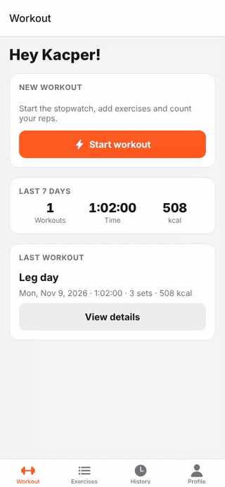
</p>

<p align="center"><a href="docs/screenshots/demo.mp4">Watch the higher-quality MP4</a></p>

## Screenshots

### Workout

|                              Home                              |                               Active workout                                |                                     Rest timer                                     |                                  Add exercise                                   |
| :------------------------------------------------------------: | :-------------------------------------------------------------------------: | :--------------------------------------------------------------------------------: | :-----------------------------------------------------------------------------: |
| 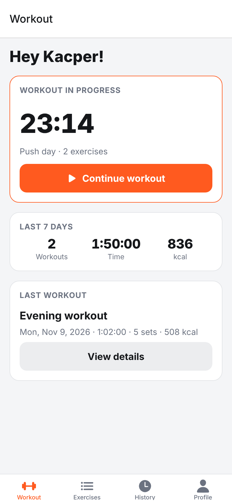 | 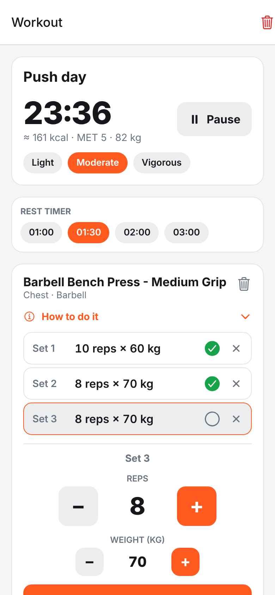 | 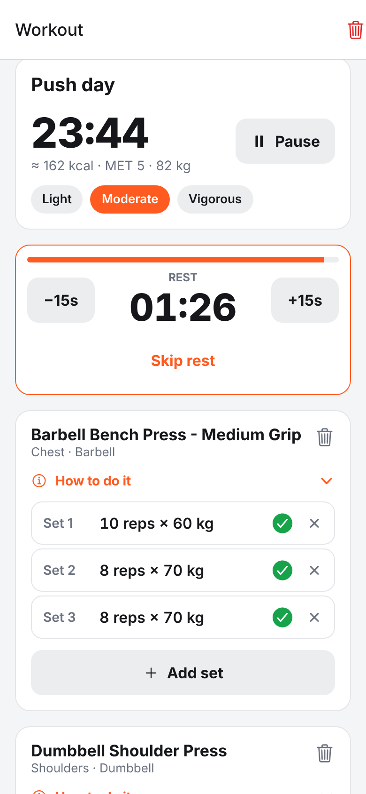 | 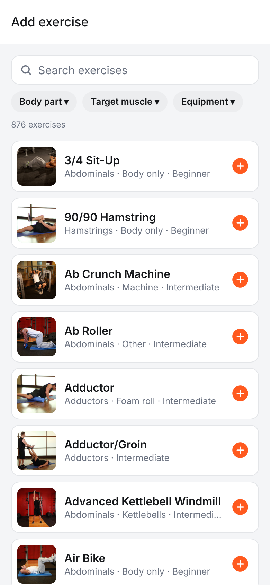 |

|                                   How to do it                                   |                                      Steps during workout                                      |                               History                                |                                   Workout details                                    |
| :------------------------------------------------------------------------------: | :--------------------------------------------------------------------------------------------: | :------------------------------------------------------------------: | :----------------------------------------------------------------------------------: |
| 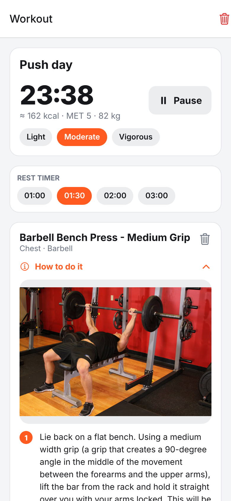 | 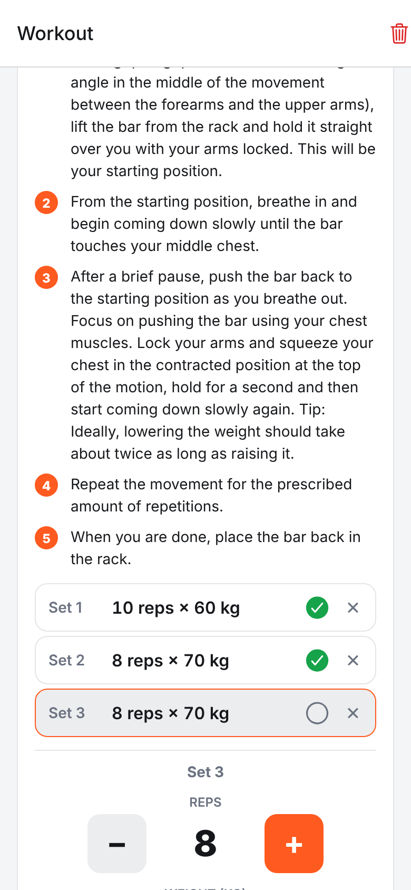 | 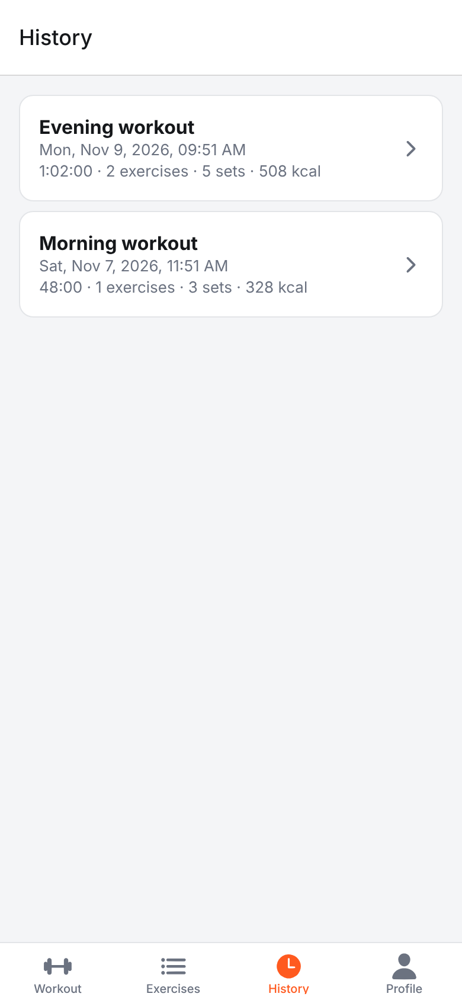 | 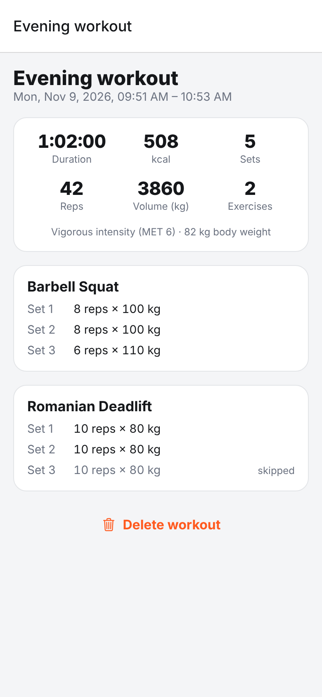 |

### Exercise catalog

|                                    Search                                    |                                       Filter: body part                                       |                                         Filter: equipment                                         |                                    Exercise details                                    |
| :--------------------------------------------------------------------------: | :-------------------------------------------------------------------------------------------: | :-----------------------------------------------------------------------------------------------: | :------------------------------------------------------------------------------------: |
| 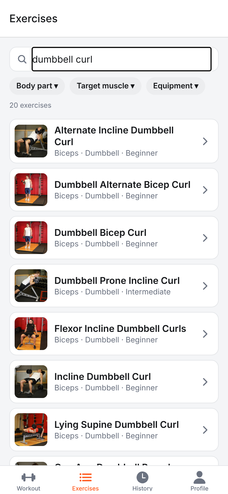 | 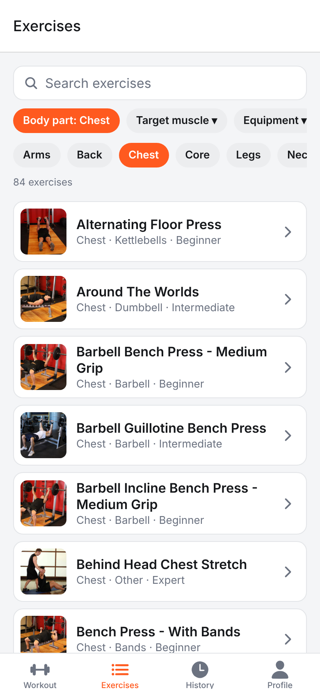 | 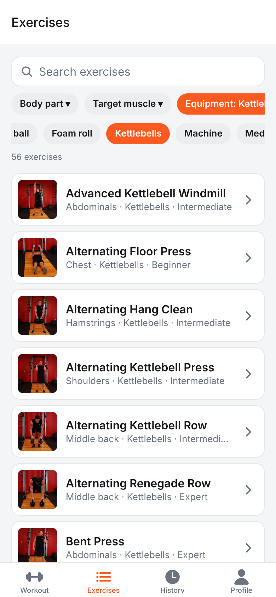 | 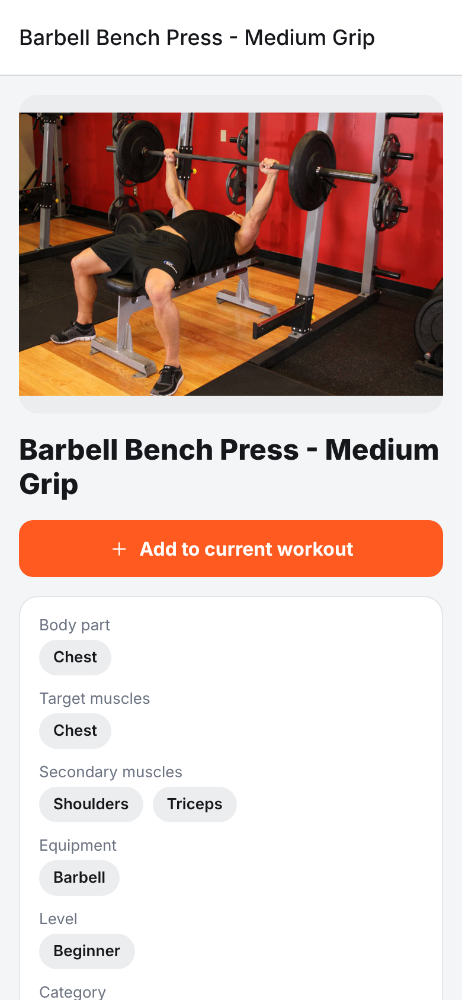 |

|                                      Instructions                                       |                                          Instructions: pullups                                           |                               Profile                                |                                      Rest timer settings                                       |
| :-------------------------------------------------------------------------------------: | :------------------------------------------------------------------------------------------------------: | :------------------------------------------------------------------: | :--------------------------------------------------------------------------------------------: |
| 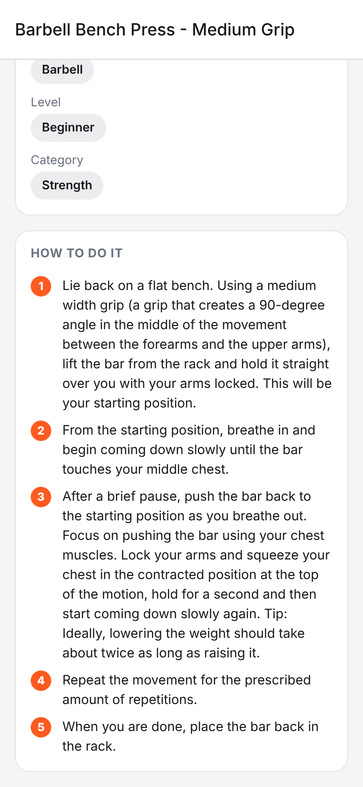 | 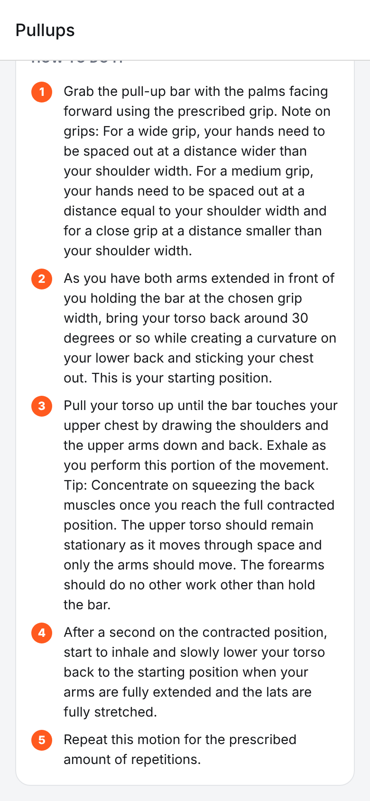 |  | 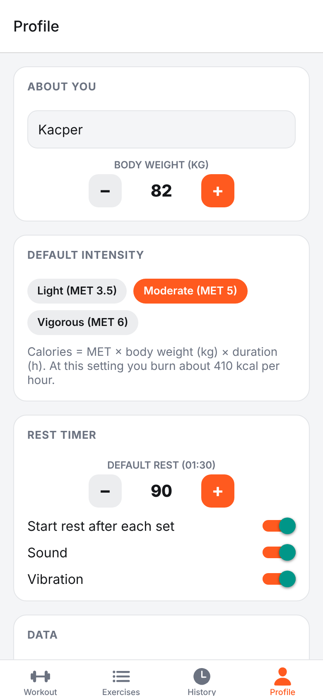 |

### Dark mode

|                                Home                                 |                                  Active workout                                  |                                   Exercises                                   |                                      Workout details                                      |
| :-----------------------------------------------------------------: | :------------------------------------------------------------------------------: | :---------------------------------------------------------------------------: | :---------------------------------------------------------------------------------------: |
| 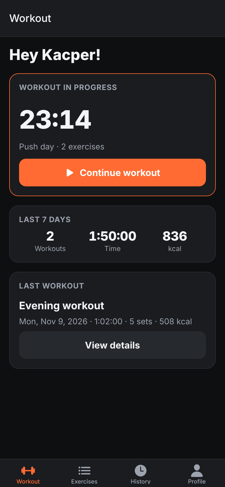 | 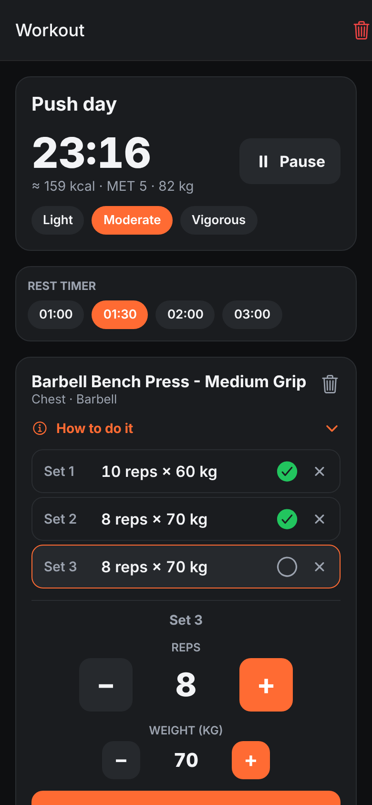 | 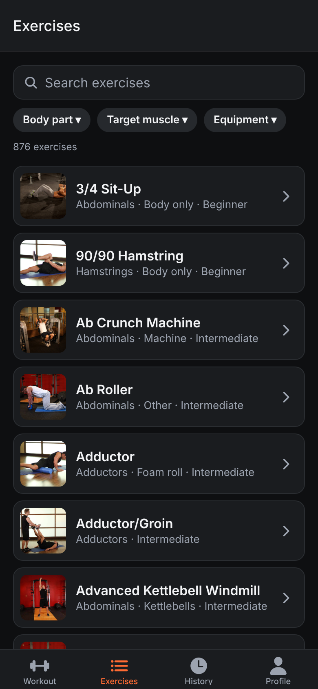 | 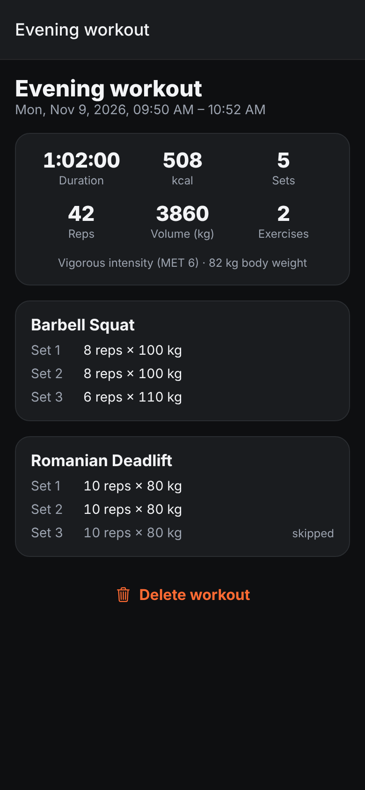 |

_Screenshots and the screencast were captured from the web build (react-native-web) at phone size, with sample workout data._

## Getting started

```bash
npm install
npm start          # Expo dev server, open in Expo Go or a simulator
npm run android    # or: npm run ios / npm run web
```

Checks:

```bash
npm run typecheck
npm test
```

## Project structure

```
src/
  app/                    Expo Router routes
    (tabs)/               Workout (home), Exercises, History, Profile
    workout/              Active workout: stopwatch, rep counter, sets, rest timer
    routine-editor/       Create and edit reusable workout routines
    pick-exercise/        Exercise picker (modal, targets workout or routine draft)
    exercise/[id]/        Exercise details
    history/[id]/         Finished workout details and save-as-routine action
  views/                  Screen views (HomeScreenView, WorkoutScreenView, RoutineEditorScreenView, ...)
  components/             UI & domain components (RoutineCard, RoutineExerciseRow, ExerciseCheckbox, Stepper, ...)
  hooks/                  Screen and component logic hooks
  lib/                    Pure logic: feature flags, routines, workout mutations, MET calories, formatting, exercise filtering (+ tests)
  services/               AsyncStorage helpers, dialogs, haptics and exercise catalog API
  state/                  AppStore, RoutinesStore, RoutineDraft, RestTimer
  theme/                  Colors, spacing, radius
```

## Feature flags

Every screen and feature can be switched on or off in code, in one file: [`src/lib/features/features.constants.ts`](src/lib/features/features.constants.ts). Change a value to `false` and that screen or feature is gone from the app.

```ts
export const FEATURES = {
  history: true, // History tab, workout details, "Last workout" card
  restTimer: true, // rest countdown and its Profile settings
  calories: false, // <- no kcal, intensity or body weight anywhere
  // ...
} as const;
```

<p align="center">
  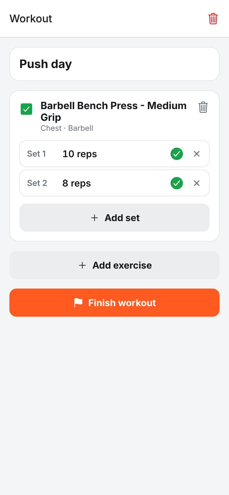
  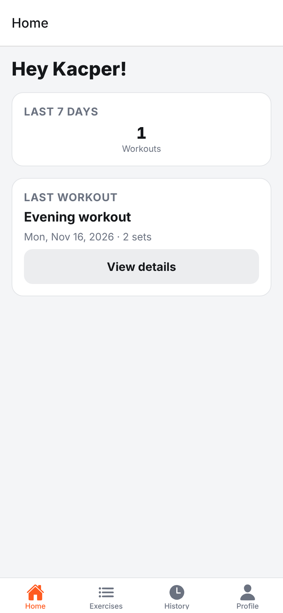
</p>

| Flag              | What it controls                                                           |
| ----------------- | -------------------------------------------------------------------------- |
| `workout`         | Active workout screen and exercise picker                                  |
| `routines`        | "My routines" on Home, routine editor, "Save as routine" (needs `workout`) |
| `exercises`       | Exercises tab                                                              |
| `exerciseDetails` | Exercise details screen                                                    |
| `history`         | History tab, workout details, "Last workout" card                          |
| `profile`         | Profile tab                                                                |
| `stopwatch`       | Workout time and pause, durations everywhere (needs `workout`)             |
| `restTimer`       | Rest countdown and its Profile settings (needs `workout`)                  |
| `calories`        | kcal estimate, intensity, body weight (needs `stopwatch`)                  |
| `weightTracking`  | Weight per set and volume; off = reps only (needs `workout`)               |
| `instructions`    | "How to do it" steps                                                       |
| `exerciseImages`  | Thumbnails and demo images                                                 |
| `catalogSearch`   | Catalog search box                                                         |
| `catalogFilters`  | Body part / muscle / equipment filters                                     |
| `weeklyStats`     | "Last 7 days" card on Home                                                 |
| `haptics`         | Haptic feedback on steppers and completed sets                             |
| `darkMode`        | Follow the system dark theme; off = always light                           |

A flag is off whenever a flag it needs is off (`FEATURE_REQUIREMENTS` in the same file). Screens behind a disabled flag are not registered with the router, so they can't be opened by navigation or deep links; a finished workout goes back to Home when `history` is off.

Usage:

```tsx
import { flags } from '@/lib/features/features';

{
  flags.restTimer && <RestTimerBar />;
}
```

To add a flag, add it to `FEATURES` (and to `FEATURE_REQUIREMENTS` if it needs another flag), then gate the UI with `flags.yourFlag`.

## Exercise data

Each exercise comes with step-by-step instructions on how to perform it correctly, demo images (start and end position), target and secondary muscles, equipment and difficulty level. Instructions are shown on the exercise details screen and in a collapsible "How to do it" section for every exercise during a workout.

Exercises come from [free-exercise-db](https://github.com/yuhonas/free-exercise-db) (public domain, ~870 exercises). The JSON file is downloaded once, cached on the device and refreshed weekly; search and filters run locally, so there are no API keys or rate limits and the catalog works offline.

To self-host the data, put `exercises.json` and the `exercises/` image folder on any static host and set `extra.exerciseData.url` / `extra.exerciseData.imageBaseUrl` in `app.json` (or the `EXPO_PUBLIC_EXERCISES_URL` / `EXPO_PUBLIC_EXERCISE_IMAGES_URL` env vars).

## Calories

`Calories = MET x body weight (kg) x duration (hours)`, with MET 3.5 / 5.0 / 6.0 for light / moderate / vigorous resistance training. Body weight and default intensity are set in the Profile tab; intensity can be changed per workout.
