# OneMoreRep

A mobile app for tracking gym workouts: count reps, browse an exercise catalog, estimate burned calories and time your rest. Built with React Native (Expo + TypeScript). See [docs/project-description.md](docs/project-description.md) for the full project description.

## Demo

<p align="center">
  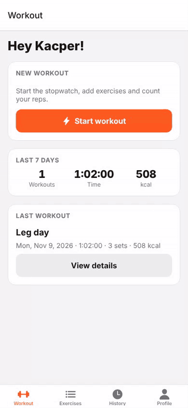
</p>

<p align="center"><a href="docs/screenshots/demo.mp4">Watch the higher-quality MP4</a></p>

## Screenshots

### Workout

| Home | Active workout | Rest timer | Add exercise |
| :---: | :---: | :---: | :---: |
| 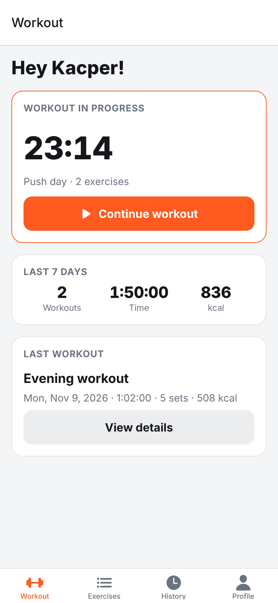 | 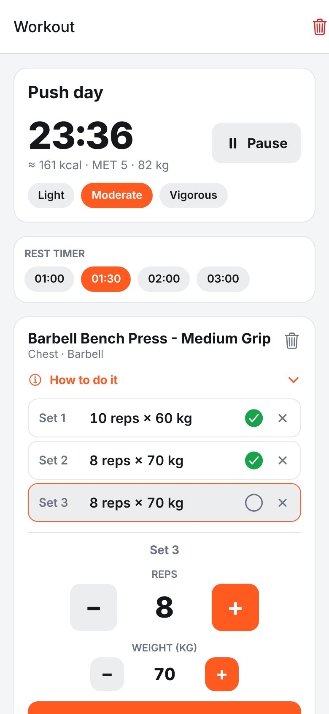 | 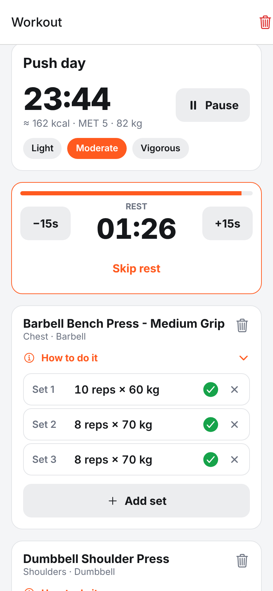 | 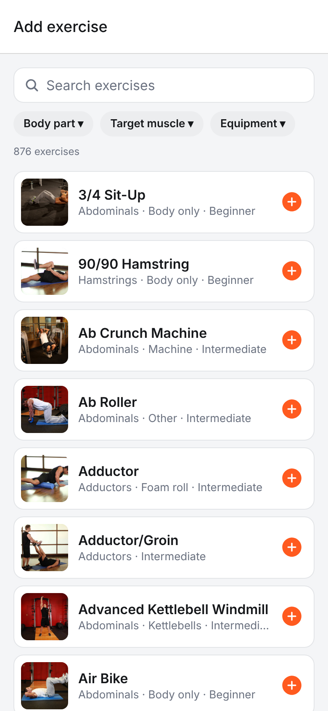 |

| How to do it | Steps during workout | History | Workout details |
| :---: | :---: | :---: | :---: |
| 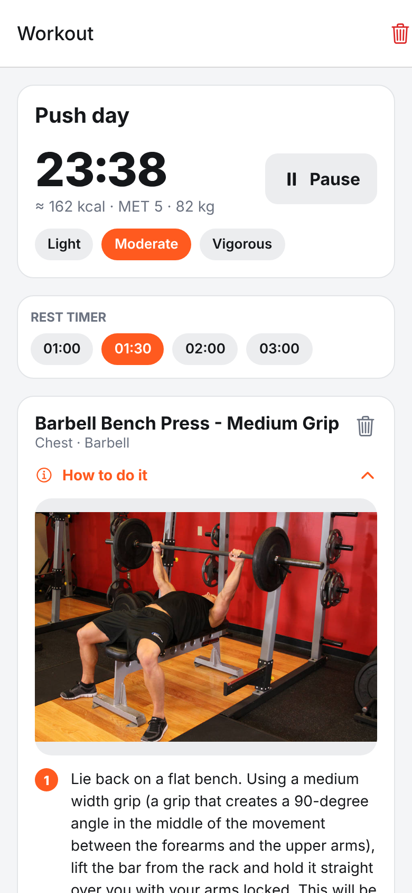 | 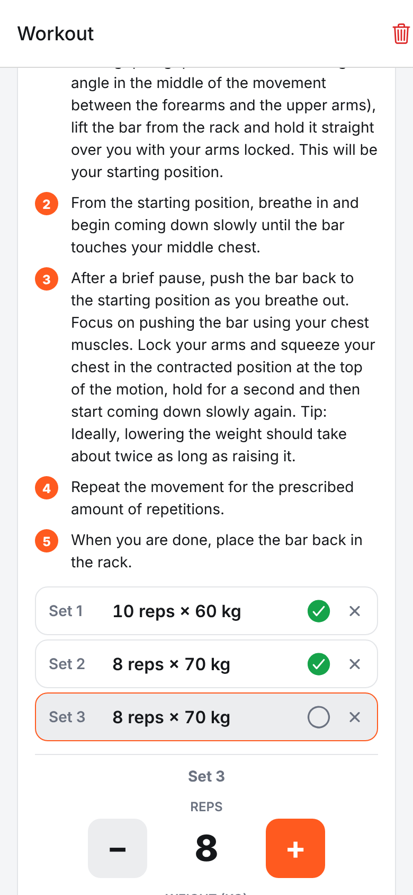 | 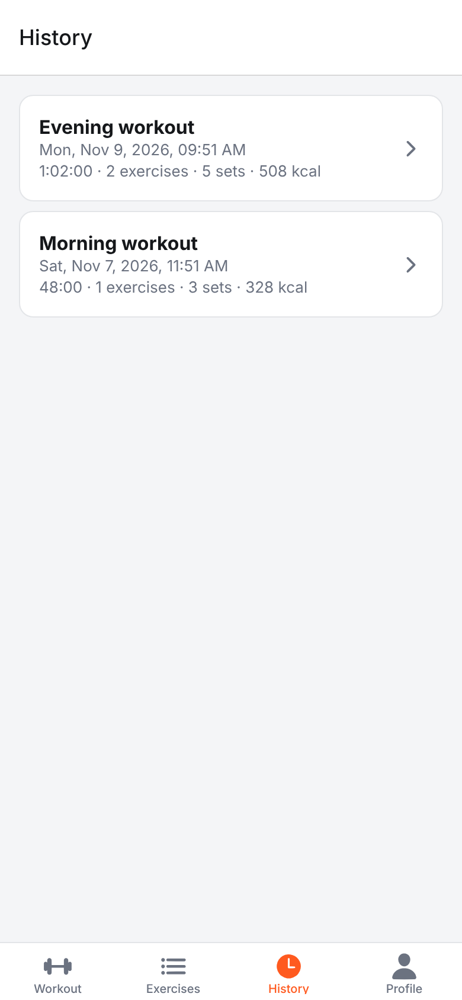 | 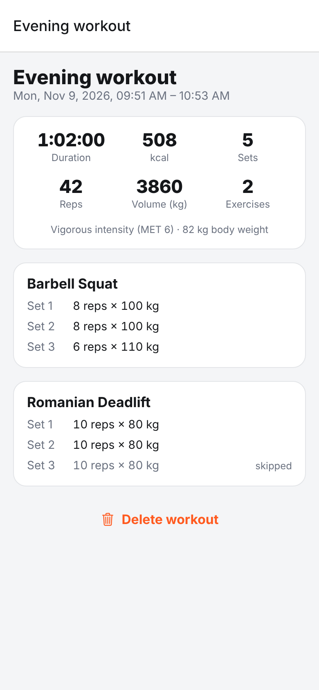 |

### Exercise catalog

| Search | Filter: body part | Filter: equipment | Exercise details |
| :---: | :---: | :---: | :---: |
| 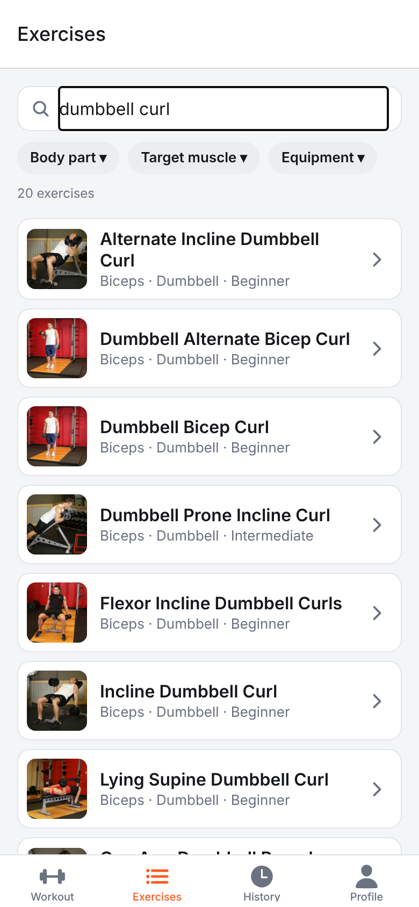 | 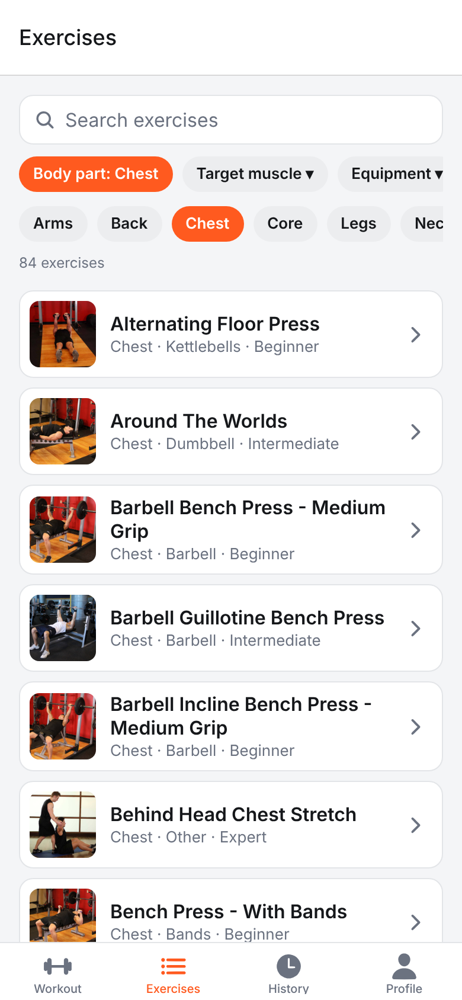 | 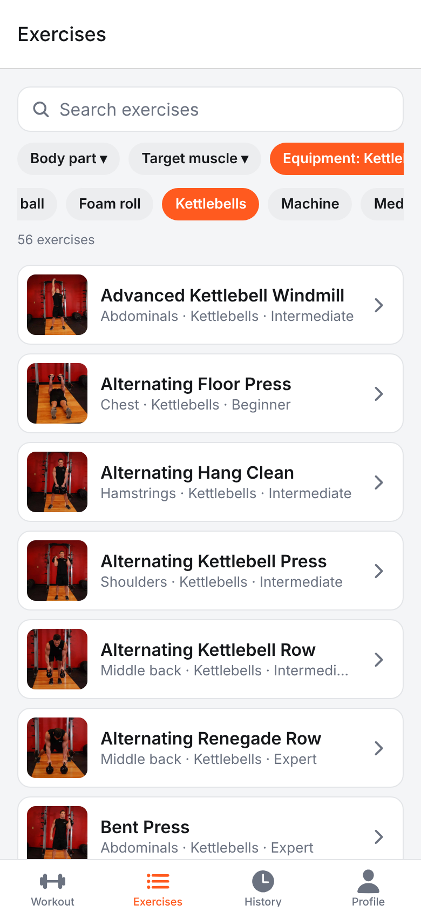 | 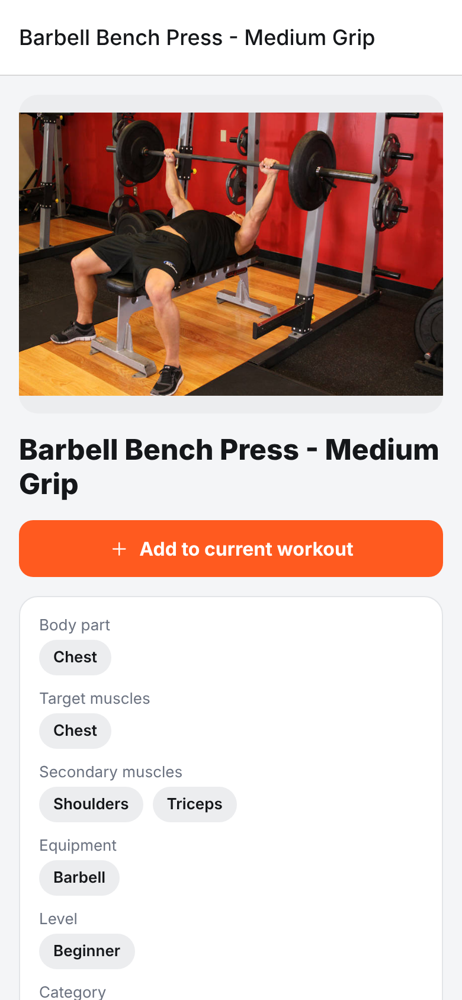 |

| Instructions | Instructions: pullups | Profile | Rest timer settings |
| :---: | :---: | :---: | :---: |
| 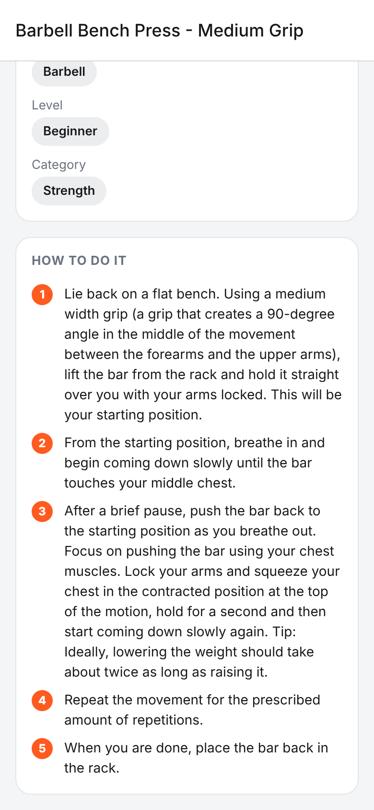 | 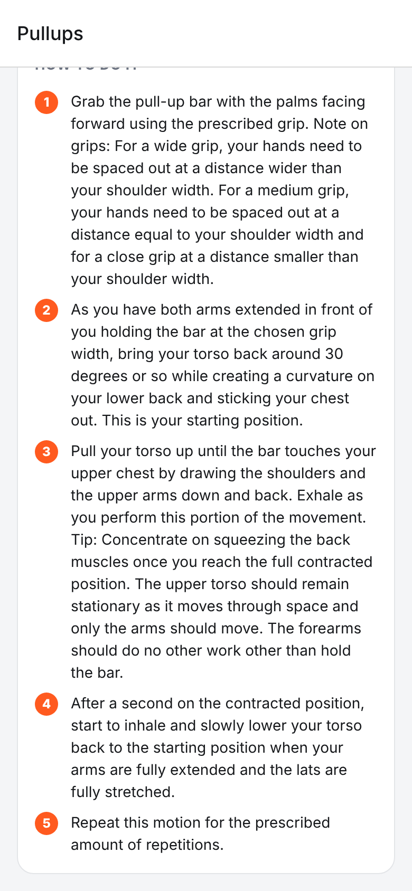 |  | 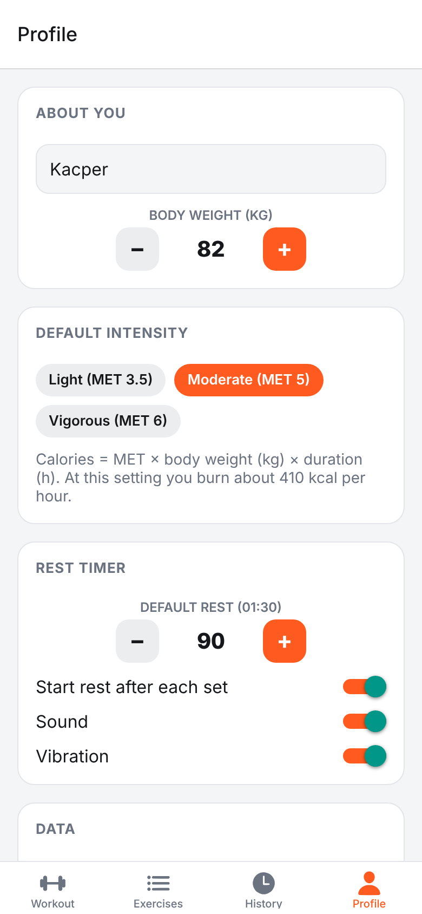 |

### Dark mode

| Home | Active workout | Exercises | Workout details |
| :---: | :---: | :---: | :---: |
| 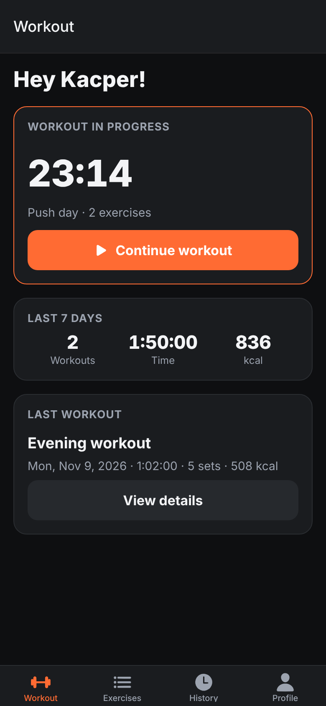 | 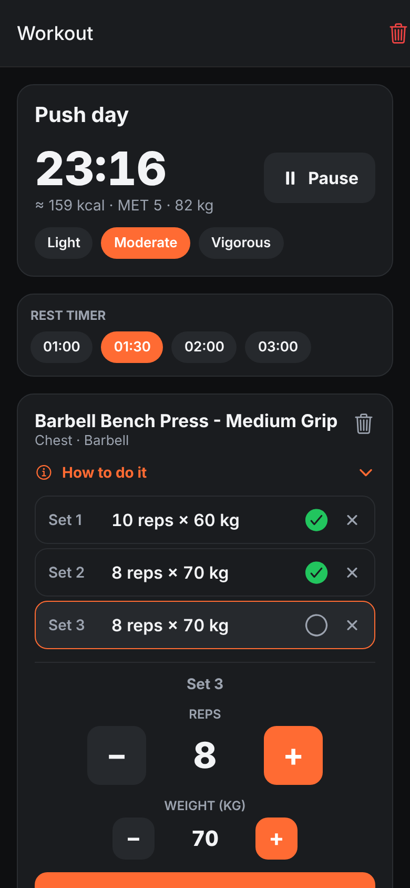 | 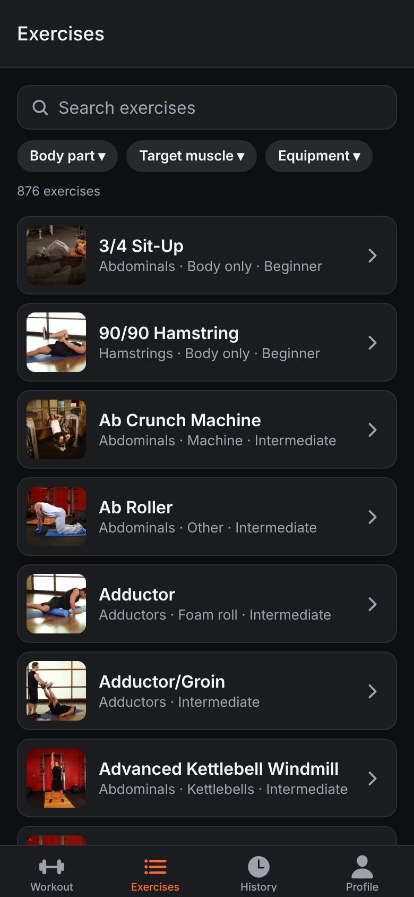 | 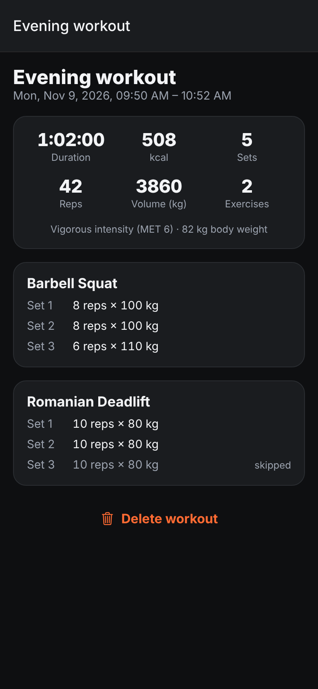 |

_Screenshots and the screencast were captured from the web build (react-native-web) at phone size, with sample workout data._

## Getting started

```bash
npm install
npm start          # Expo dev server, open in Expo Go or a simulator
npm run android    # or: npm run ios / npm run web
```

Checks:

```bash
npm run typecheck
npm test
```

## Project structure

```
src/
  app/                    Expo Router screens
    (tabs)/               Workout (home), Exercises, History, Profile
    workout.tsx           Active workout: stopwatch, rep counter, sets, rest timer
    pick-exercise.tsx     Exercise picker (modal)
    exercise/[id].tsx     Exercise details
    history/[id].tsx      Finished workout details
  components/             UI components (Stepper, RestTimerBar, ExerciseCatalog, ...)
  lib/                    Pure logic: types, MET calories, formatting, exercise filtering (+ tests)
  services/
    exerciseApi.ts        The only module that talks to the exercise data source
    storage.ts            AsyncStorage helpers
  state/
    AppStore.tsx          Profile, active workout and history (persisted locally)
    RestTimer.tsx         Rest countdown with sound and vibration
```

## Exercise data

Each exercise comes with step-by-step instructions on how to perform it correctly, demo images (start and end position), target and secondary muscles, equipment and difficulty level. Instructions are shown on the exercise details screen and in a collapsible "How to do it" section for every exercise during a workout.

Exercises come from [free-exercise-db](https://github.com/yuhonas/free-exercise-db) (public domain, ~870 exercises). The JSON file is downloaded once, cached on the device and refreshed weekly; search and filters run locally, so there are no API keys or rate limits and the catalog works offline.

To self-host the data, put `exercises.json` and the `exercises/` image folder on any static host and set `extra.exerciseData.url` / `extra.exerciseData.imageBaseUrl` in `app.json` (or the `EXPO_PUBLIC_EXERCISES_URL` / `EXPO_PUBLIC_EXERCISE_IMAGES_URL` env vars).

## Calories

`Calories = MET x body weight (kg) x duration (hours)`, with MET 3.5 / 5.0 / 6.0 for light / moderate / vigorous resistance training. Body weight and default intensity are set in the Profile tab; intensity can be changed per workout.
